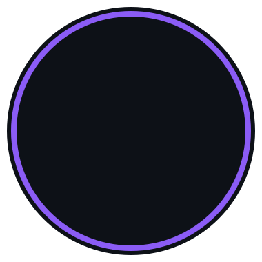

 

  

  

---

## ✨ About me

Hi! I'm **Sara Cervantes**, a software development student at **ADSO — SENA Centro Colombo Alemán** and an **Artificial Intelligence and Data Science Engineering** student.

I enjoy turning ideas into practical digital products and exploring how **software, data, and AI** can work together. I learn by building: from mobile and web applications to data projects and dashboards.

- 💻 Interested in **software development, web and mobile applications, AI, and data science**
- 🧠 Currently strengthening my skills in **Python, Kotlin, JavaScript, databases, and machine learning**
- 🚀 Motivated by thoughtful solutions, continuous learning, and projects with real-world impact
- 🌎 Based in **Colombia**

---

## 🏆 A project I'm proud of

### 🥉 3rd place — SuperBrixIA / BRIX360

I contributed to **BRIX360**, an Android application created for industrial operations. The project helps teams register production events and uses AI-assisted classification to support operational tracking. It brings together a mobile app, a backend, and reporting integrations.

---

## 🧰 Technologies & tools

### Languages

### Frameworks & platforms

### Data, databases & tools

 

---

## 🚀 Featured projects

<table>
  <tr>
    <td width="50%" valign="top">
      <h3>🏭 SuperBrixIA / BRIX360</h3>
      
Android application for industrial event reporting, with AI-assisted classification and offline-first workflows.

      
<code>Kotlin</code> <code>Jetpack Compose</code> <code>FastAPI</code> <code>AI</code>

      <a href="https://github.com/cervantessaralucia4-dotcom/SuperBrixIA">View repository →</a>
    </td>
    <td width="50%" valign="top">
      <h3>🥗 FocusMeal</h3>
      
Android nutrition app for tracking meals, nutrients, goals, and progress.

      
<code>Kotlin</code> <code>Jetpack Compose</code> <code>Firebase</code>

      <a href="https://github.com/cervantessaralucia4-dotcom/FocusMealApp">View repository →</a>
    </td>
  </tr>
  <tr>
    <td width="50%" valign="top">
      <h3>💄 Velvet Beauty</h3>
      
A beauty and cosmetics e-commerce project with a modern web experience.

      
<code>Next.js</code> <code>TypeScript</code>

      <a href="https://github.com/cervantessaralucia4-dotcom/velvet-beauty">View repository →</a>
    </td>
    <td width="50%" valign="top">
      <h3>📊 SmartMarket</h3>
      
Data engineering and machine learning project featuring data validation, transformation, and analysis.

      
<code>Python</code> <code>Pandas</code> <code>Scikit-learn</code>

      <a href="https://github.com/cervantessaralucia4-dotcom/Reto-SmartMarket">View repository →</a>
    </td>
  </tr>
</table>

  

---

## 📊 GitHub at a glance

 

 

---

## 🤝 Let's connect

Have an idea, a project, or an opportunity to collaborate? I'd love to hear from you!

  

*“Small progress every day leads to big results.”*

