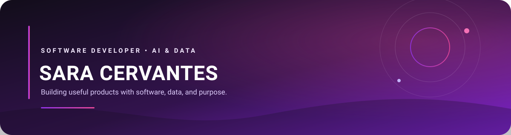
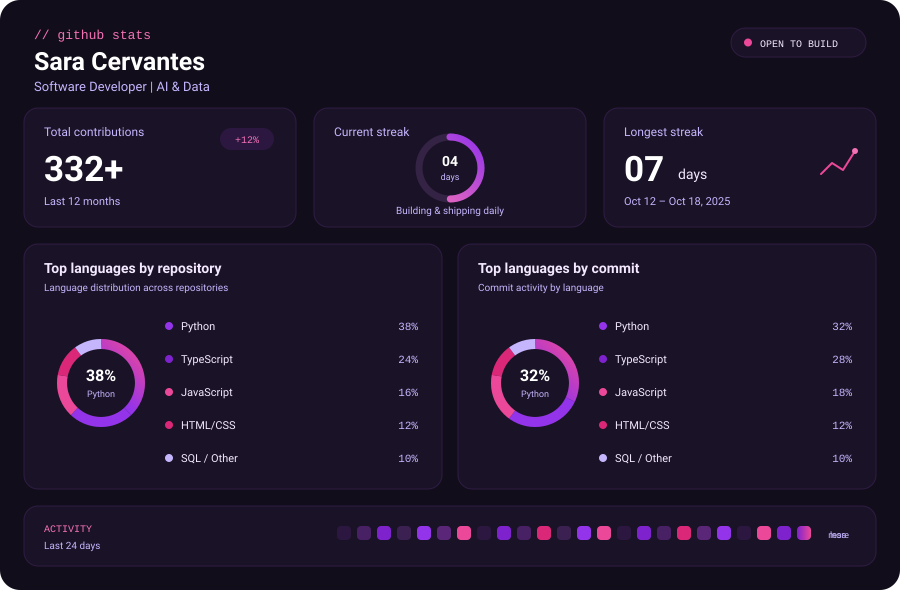

 

  

 

---

## ✦ About me

I'm **Sara Cervantes**, a software development student at **ADSO — SENA Centro Colombo Alemán** and an **Artificial Intelligence and Data Science Engineering** student.

I enjoy transforming ideas into useful digital products and exploring how **software, data, and AI** can work together. I learn by building—from web and mobile applications to analytics projects and AI-driven solutions.

| Focus | What I enjoy building |
|:--|:--|
| **Software** | Web and mobile applications with thoughtful user experiences |
| **AI & Data** | Data pipelines, machine learning experiments, and clear visualizations |
| **Growth** | Practical projects, collaboration, and continuous learning |

---

## ✧ Selected projects

<table>
  <tr>
    <td width="50%" valign="top">
      <h3>Soportix</h3>
      
Helpdesk platform with role-based access, ticket tracking, comments, file attachments, and reporting dashboard.

      

        
        
      

      <a href="https://github.com/bleidys16/Soportix">Explore repository →</a>
    </td>
    <td width="50%" valign="top">
      <h3>Inmobiliaria</h3>
      
Real-estate website presenting property listings in a clean, accessible digital experience.

      

        
        
      

      <a href="https://github.com/cervantessaralucia4-dotcom/inmobiliaria">Explore repository →</a>
    </td>
  </tr>
  <tr>
    <td width="50%" valign="top">
      <h3>pipeline-reto</h3>
      
Intelligent clinical analytics platform focused on data processing and healthcare insights.

      

        
        
      

      <a href="https://github.com/cervantessaralucia4-dotcom/pipeline-reto">Explore repository →</a>
    </td>
    <td width="50%" valign="top">
      <h3>SuperBrixIA / BRIX360</h3>
      
Android solution for industrial event reporting, AI-assisted classification, and operational monitoring.

      

        
        
      

      <a href="https://github.com/cervantessaralucia4-dotcom/SuperBrixIA">Explore repository →</a>
    </td>
  </tr>
</table>

  

---

## ✧ Tools & technologies

  

---

## `// github stats`

---

## ✧ Let's connect

Open to collaboration, internships, and projects with real-world impact.

  

Progress is built one thoughtful step at a time.

